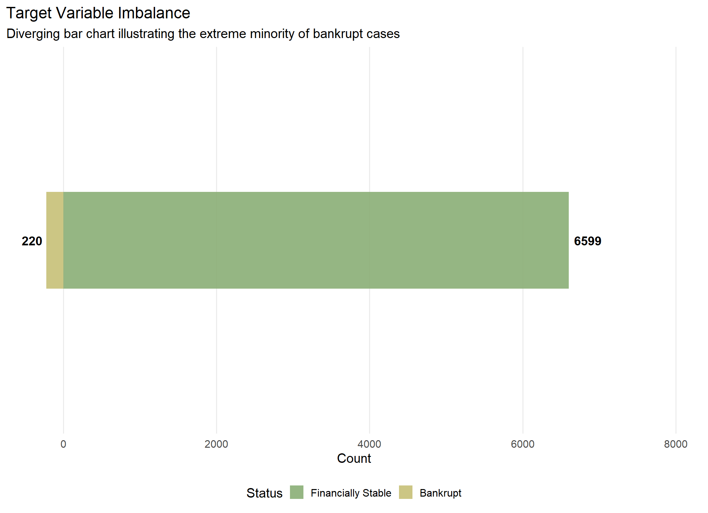
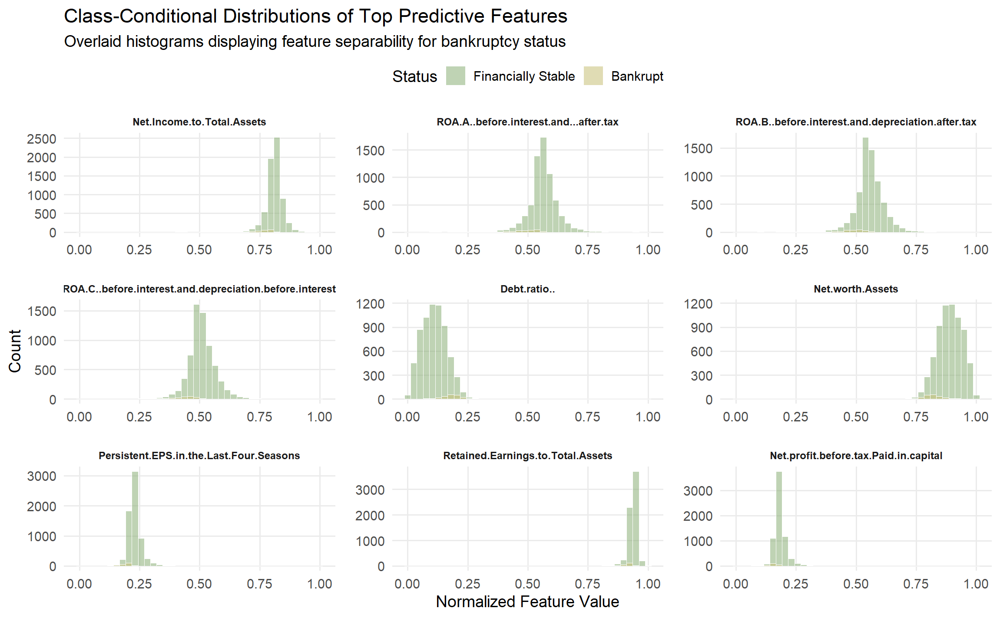
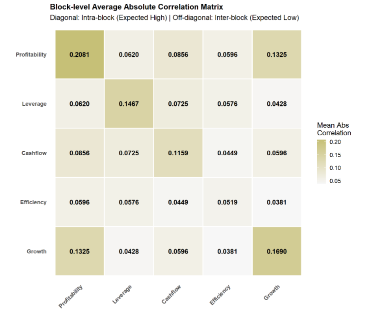
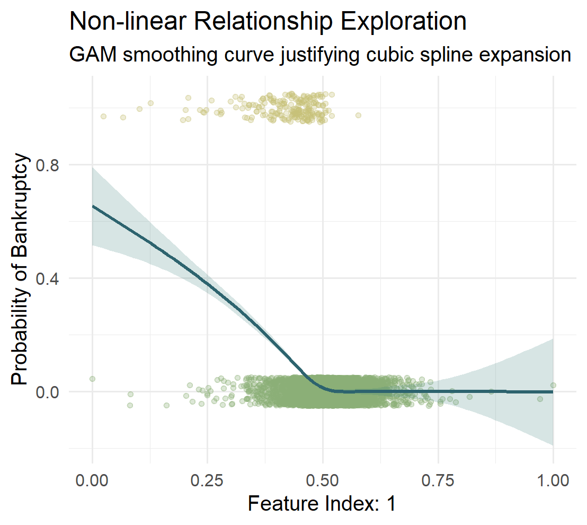
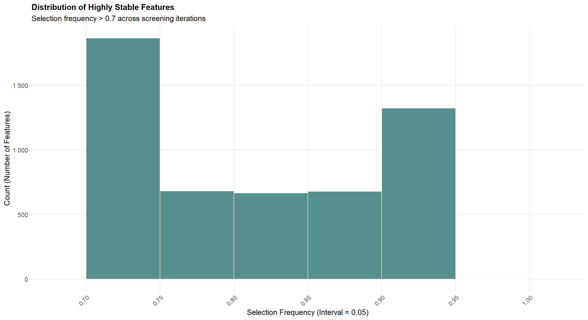
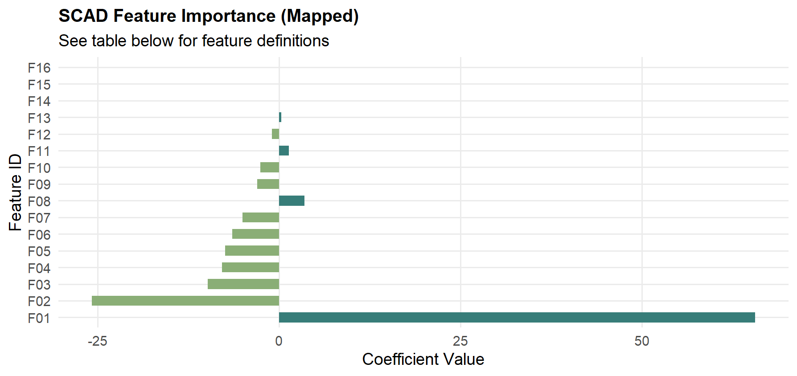
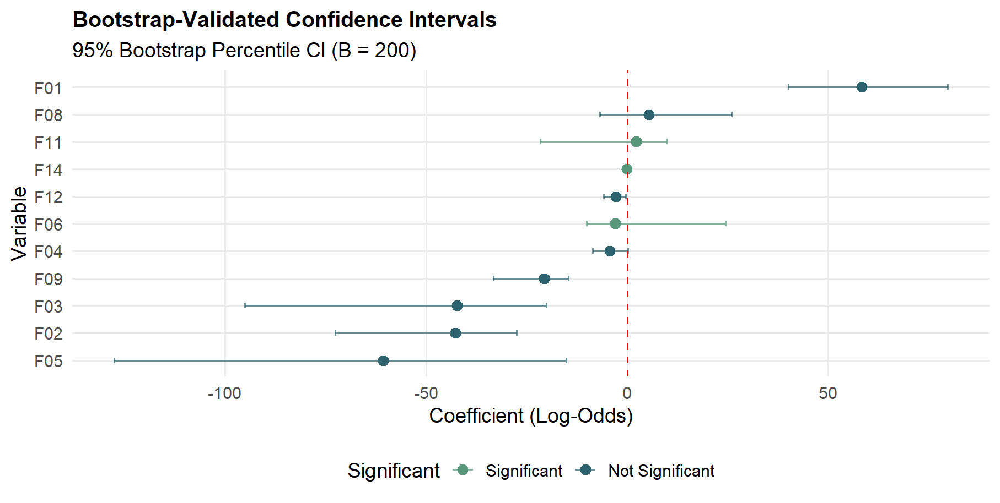
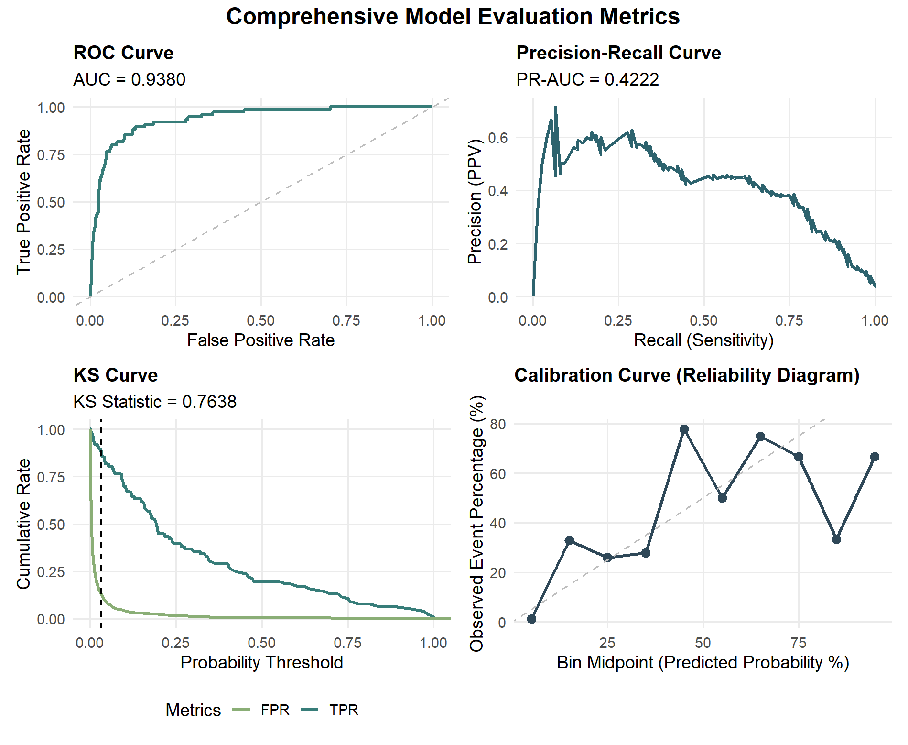
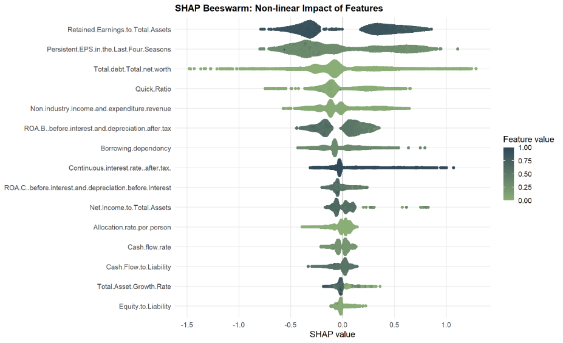
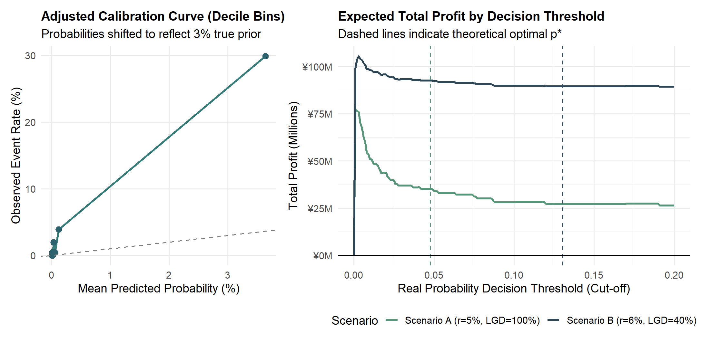

<div align="center">

# 企业破产是"多维度非线性共振"吗？

**基于 GCor-SIS-REDS-MDS 超高维筛选与代价敏感 SCAD 惩罚回归的实证分析**

6,819 家台湾企业（1999–2009）｜94 个财务指标 → 31,616 维交互特征空间 → 16 个风险枢纽

</div>

---

## 一句话结论

> 把 94 个财务指标按杜邦分析法分成 5 个经济模块，用**自然三次样条**展开后做**模块间张量积交叉**，显式构造出 **31,616 维**特征空间（原始维度的 **336 倍**）；
> 经 **GCor-SIS-REDS-MDS**（α = 0.1、20 次独立拆分、频率 > 0.7）筛出 **5,218 个候选**，再由 **SCAD 惩罚 logistic**（10 折 CV、γ = 3.7、类别权重 32.15）压缩到 **16 个非零系数特征**——其中 **15 个是交互项**、**13 个含杠杆模块**；
> 测试集上 **ROC-AUC = 0.9380、KS = 0.7638、召回 0.8947**，但 **精确率仅 0.2086**（破产样本仅占 3.23%，这是不平衡数据的必然代价）。
>
> 然而本项目最想讲清的是**两个反直觉的结果**：**①** 换成统计上有效的**拆分样本推断**后，能通过 5% 显著性检验的变量从 11 个中的 **8 个锐减到 2 个**——"显著"在相当程度上是选择偏差的产物；**②** 论文表 5 中报告的 LightGBM / SMOTE 对照结果，其对应的 `data/04_*.RData` **不在本仓库中，因而未被复核**，README 与 `results/tables/` 只把可回溯到落盘文件的主模型数字视为结论。

完整论文见 [`docs/正文.pdf`](docs/正文.pdf)（中文，正文约 32 页，含代码附录）；全部可核验数值见 [`results/tables/`](results/tables)。

---

## 目录

- [一、研究问题：为什么不能"看相关性选变量"](#一研究问题为什么不能看相关性选变量)
- [二、核心发现](#二核心发现)
- [三、方法原理](#三方法原理)
- [四、实证结果](#四实证结果)
- [五、项目结构](#五项目结构)
- [六、复现指南](#六复现指南)
- [七、这个项目体现了哪些能力](#七这个项目体现了哪些能力)
- [八、局限与已知问题](#八局限与已知问题)
- [九、参考文献与引用](#九参考文献与引用)
- [十、致谢与 AI 使用声明](#十致谢与-ai-使用声明)

---

## 一、研究问题：为什么不能"看相关性选变量"

数据本身说明了为什么传统做法在这里会失效。以下事实全部来自 `data/data.csv` 与训练集（可用 [`scripts/99_export_result_tables.R`](scripts/99_export_result_tables.R) 复算）：

| 维度 | 事实 | 含义 |
|------|------|------|
| 类别不平衡 | 破产 **220 / 6,819 = 3.23%**（训练集 144/4,773 = 3.02%，测试集 76/2,046 = 3.71%） | 正类先验极低，无惩罚 logistic 会系统性偏向多数类 |
| 单变量信号 | 94 个特征与破产的绝对点二列相关**中位数仅 0.0615**、均值 0.0812；**只有 1 个**特征 \|r\| ≥ 0.3（Net Income to Total Assets，0.3084），8 个 ≥ 0.2，**65 个 < 0.1** | 单变量线性判别天花板很低，靠"选相关最强的 k 个变量"难以刻画破产机制 |
| 模块结构 | 5 个经济模块**类内**平均绝对相关 **0.1443**，**类间**仅 **0.0715**（约 2.0 倍）；模块规模 Prof 20 / Lev 21 / Cash 21 / Eff 17 / Grow 15 | 信息高度冗余且集中在模块内部 → 直接上全部变量必然多重共线性 |
| 线性模型失效 | 分块多元 logistic 的对数几率被推到 −2000 甚至 −4000（论文第 4 节、`docs/正文.pdf`） | 无惩罚极大似然在近似完全分离下参数估计发散，伪 R² 不可信 |

因此本文的路线是：**不回避高维，而是显式构造"非线性阈值 + 高阶交互"的特征空间，再用带 FDR 控制的筛选把假阳性压住**，最后用具备 Oracle 性质的惩罚回归做稀疏化与推断。

<table>
<tr>
<td width="42%"></td>
<td width="58%"></td>
</tr>
<tr>
<td align="center"><b>图 1</b>　破产与健康企业的数量对比（220 vs 6,599）</td>
<td align="center"><b>图 2</b>　相关性最强 15 个特征的类别条件分布：部分特征呈现明显的阈值效应</td>
</tr>
</table>

<table>
<tr>
<td width="50%"></td>
<td width="50%"></td>
</tr>
<tr>
<td align="center"><b>图 3</b>　模块级平均绝对相关：对角线（类内）显著高于非对角线（类间）</td>
<td align="center"><b>图 4</b>　GAM 平滑曲线：线性假设不成立，需要样条展开</td>
</tr>
</table>

---

## 二、核心发现

| 结论 | 证据来源 | 关键数值 |
|------|----------|----------|
| 单变量信号极度稀疏，必须借助交互与非线性展开 | [`univariate_signal.csv`](results/tables/univariate_signal.csv) | \|r\| 中位数 **0.0615**；仅 **1 / 94** 个特征 \|r\| ≥ 0.3 |
| 特征空间被显式放大到超高维 | [`expansion_summary.csv`](results/tables/expansion_summary.csv) | 94 → **31,616** 维（**336.3×**）= 94 主效应 + 280 样条基 + **31,242 交互项** |
| SIS 把假阳性压住，但保留了千级候选 | [`sis_selection_summary.csv`](results/tables/sis_selection_summary.csv) | 31,616 → 26,552（至少入选 1 次）→ **12,043**（τ=0.5）→ **5,218**（>0.7） |
| 没有任何特征在 20 次拆分中被 100% 选中 | [`sis_frequency_bins.csv`](results/tables/sis_frequency_bins.csv) | 最高频率 **0.95**，频率 = 1.0 的特征数 **0** → 多重拆分（MDS）是必要的 |
| SCAD 把候选压缩到 16 个可解释的枢纽 | [`scad_selected_features.csv`](results/tables/scad_selected_features.csv) | **16** 个非零系数，其中 **15** 个交互项、**13** 个含杠杆模块、**11** 个含 ns2/ns3 基函数 |
| 判别能力强，但精确率受不平衡数据压制 | [`model_metrics_scad.csv`](results/tables/model_metrics_scad.csv) | AUC **0.9380**、KS **0.7638**、召回 **0.8947**、精确率 **0.2086**、F1 0.3383 |
| 后选择推断的显著性高度依赖推断方案 | [`post_selection_inference_full.csv`](results/tables/post_selection_inference_full.csv)、[`post_selection_inference_split.csv`](results/tables/post_selection_inference_split.csv) | 全量重拟合 **8 / 11** 显著（Bootstrap 区间平均为 Wald 的 **3.86 倍**）；拆分样本后仅 **2** 个变量入选且均显著 |
| 代价敏感决策：漏报远比误杀昂贵 | [`economic_scenarios.csv`](results/tables/economic_scenarios.csv) | 最优阈值 0.0317 ⇒ 漏报/误杀成本比 **30.5 : 1**；两个放贷情景净利润 **3,510 万元** / **8,944 万元** |

<table>
<tr>
<td width="50%"></td>
<td width="50%"></td>
</tr>
<tr>
<td align="center"><b>图 5</b>　20 次拆分的特征选择频率：集中在 (0.70, 0.75] 与 (0.90, 0.95]</td>
<td align="center"><b>图 6</b>　SCAD 最终 16 个非零系数特征（编号映射见表 2）</td>
</tr>
</table>

> **一句话解读**：企业破产不是"某个指标变差"，而是**杠杆与其他维度（效率、成长、现金流、盈利）在特定阈值上的非线性共振**——16 个幸存特征中 13 个含杠杆模块，且 11 个落在样条的 ns2/ns3 区间（非线性的高曲率段）。但同样必须承认：**这些"显著性"结论在拆分样本后大幅收缩**，说明它们的稳定性远不如点估计给人的印象。

---

## 三、方法原理

### 3.1 特征工程：从 94 个财务指标到 31,616 维

**第一步，经济模块化。** 依照杜邦分析法把 94 个财务指标划入 5 个模块（盈利能力、偿债与杠杆、现金流与流动性、营运效率、成长与每股规模）。模块规模由落盘特征空间的列名反解验证：Prof 20、Lev 21、Cash 21、Eff 17、Grow 15，合计 94，与 [`block_membership.csv`](results/tables/block_membership.csv) 一致。

**第二步，自然三次样条展开（NCS）。** 对每个连续变量以 `ns(x, df = 3)` 展开，获得 3 个基函数列（ns1–ns3），用训练集的结点映射到测试集。相比多项式，NCS 的边界线性约束能抑制端点振荡。唯一的例外是 `Liability-Assets Flag`（94 维矩阵中的第 85 列）：该变量取值极端集中导致结点重合，脚本捕获异常后**降级为线性项**，因此样条基列数为 93 × 3 + 1 = **280**（[`spline_expansion_note.csv`](results/tables/spline_expansion_note.csv)）。

**第三步，模块间张量积交叉。** 对 5 个模块做两两交叉（C(5,2) = 10 组），每个变量对的两个基函数相乘，得到 31,242 个交互项列。这一步是本项目的核心设计：**不依赖遗传性原则先筛主效应，而是把"纯交互效应"直接放进候选池**。

$$
X_{\text{ultra}} = \big[\, X \;\big|\; \{\text{ns}_j(x_k)\} \;\big|\; \{\text{ns}_a(x_i)\cdot \text{ns}_b(x_j)\}_{i<j} \,\big], \qquad 94 \to 31{,}616
$$

### 3.2 GCor-SIS-REDS-MDS：带 FDR 控制的超高维筛选

Jiang 等（2025）以 **Grothendieck 相关**度量特征与响应之间的边际依赖：把 $x$ 与 $y$ 分别映为 $\arcsin\big((x_ix_j+1)/\sqrt{(x_i^2+1)(x_j^2+1)}\big)$ 形式的核矩阵，中心化后求内积平方根得到 $\omega$。它同时捕捉线性和非线性依赖，且对重尾稳健——这正对应本项目"**不做任何缩尾处理**"的选择。

单次筛选把样本随机拆成 $D_1$（2/3）与 $D_2$（1/3），构造

$$
M_r \;=\; \operatorname{sign}(n_1\omega_1 - n_2\omega_2)\,\max(n_1\omega_1,\; n_2\omega_2)
$$

再在候选阈值上取满足 $\big(1+\#\{M \le -t\}\big)/\max(\#\{M \ge t\},1) \le \alpha$ 的最小 $t$ 作为截断，从而把错误发现率控制在 $\alpha$ 以内。计算复杂度 $O(np\log n)$，低于 BCor-SIS 与 PC-SIS。

**MDS（多重数据拆分）** 是针对单次拆分不稳健的补救：重复 $B=20$ 次独立拆分，记录每个变量被选中的频率 $\Pi_j$，仅保留 $\Pi_j > 0.7$ 的变量（Meinshausen & Bühlmann 2010 的稳定性选择思想）。本项目在 R 中用 **Rcpp 手写核矩阵** + **20 核并行**（`doParallel`/`foreach`）实现，并把频率阈值设得比脚本的 τ = 0.5 更严（0.7），因为落盘结果显示 τ = 0.5 时仍有 12,043 个特征，无法支撑后续 SCAD 的稳定求解。

> **工程选择**：核矩阵计算没有调用任何现成包，而是把三重循环写成 C++（[`scripts/GCor_SIS_REDS_MDS.R`](scripts/GCor_SIS_REDS_MDS.R)），只分配一次 $n\times n$ 缓冲区、按列索引取数以避免 R 层对象复制；筛选阶段则"算完即销毁"分块矩阵（`rm()` + `gc()`）。这些选择是为了让 31,616 × 4,773 的矩阵能在单机上跑完。

### 3.3 代价敏感 SCAD 惩罚 logistic

对筛选后的 5,218 维候选拟合 SCAD 惩罚 logistic：

$$
\hat\beta = \arg\min_{\beta}\Big\{ -\frac{1}{n}\sum_{i=1}^{n} w_i\big[y_i \log p_i + (1-y_i)\log(1-p_i)\big] + \sum_{j=1}^{p} p_\lambda(|\beta_j|) \Big\},
\qquad p_i = \frac{1}{1+e^{-x_i^\top\beta}}
$$

$$
p_\lambda(\theta) = \lambda |\theta| \ \ (\theta \le \lambda);\quad -\frac{\theta^2 - 2a\lambda\theta + \lambda^2}{2(a-1)} \ \ (\lambda < \theta \le a\lambda);\quad \frac{(a+1)\lambda^2}{2} \ \ (\theta > a\lambda)
$$

其中 $a = 3.7$（原作者建议值），$\lambda$ 在 150 个点的网格上用 **10 折交叉验证**选取（`lambda.min = 0.004611`）。**代价敏感权重**取 $w_i = n_0/n_1 = 4{,}629/144 = 32.15$（正类加权），使少数类错分与多数类整体错分同权——相比 SMOTE 等重采样，这种方式不改变原始联合分布。

### 3.4 后选择推断：两套方案，结论不同

SCAD 的系数带惩罚偏差，p 值不能直接用惩罚估计量计算，因此项目实现了**两套**后选择推断并做了对照：

| 方案 | 做法 | 统计性质 |
|------|------|----------|
| **A. 全量重拟合**（[`03_SCAD.R`](scripts/03_SCAD.R)） | 在同一份训练集上，对 SCAD 选出的变量做（加权）无惩罚 logistic 重拟合；剔除标准误 > 10 的分离变量；Bootstrap B = 200 计算百分位区间 | 变量选择与推断使用同一份数据 → **存在选择偏差**，p 值乐观 |
| **B. 拆分样本**（[`03_SCAD_Split.R`](scripts/03_SCAD_Split.R)） | 训练集随机拆成 A / B：A（n = 2,386，加权）做 SCAD 选择，B（n = 2,387，无权重）只做 logistic 推断与 Bootstrap | 推断数据未参与选择 → p 值与区间**统计上有效** |

两套方案的结果差异，本身就是一个值得报告的经验发现（见 4.4）。

---

## 四、实证结果

### 4.1 筛选路径

`03_SIS.R` 以 20 次独立拆分运行 GCor-SIS-REDS-MDS，落盘每个特征的入选频率：

| 阶段 | 维度 | 说明 |
|------|------|------|
| 显式构造 | 31,616 | 94 主效应 + 280 样条基 + 31,242 交互项 |
| 至少入选 1 次 | 26,552 | 占全部特征的 84.0% |
| 频率 ≥ 0.5（脚本 τ） | 12,043 | 仍远超 SCAD 可稳定求解的规模 |
| **频率 > 0.7（实际建模口径）** | **5,218** | 论文正文所报"筛选出 5,218 个特征"即此口径 |
| SCAD 非零系数 | **16** | 10 折 CV 选 λ，γ = 3.7 |

频率分布见 [`sis_frequency_bins.csv`](results/tables/sis_frequency_bins.csv)：两个高频峰位于 (0.70, 0.75]（1,866 个）与 (0.90, 0.95]（1,324 个）；**没有任何特征达到频率 1.0**（最高 0.95），说明即便对最有信息量的变量，单次拆分的硬截断也会使其偶尔跌出边界——这是本项目引入 MDS 的直接经验证据。

### 4.2 16 个幸存特征的构成

> **编号口径**：`F01–F16` 按 SCAD 系数绝对值降序编号（与论文表 3 一致），完整映射见 [`scad_selected_features.csv`](results/tables/scad_selected_features.csv)。

| 组成维度 | 数量 | 说明 |
|----------|------|------|
| 交互项 / 纯线性主效应 | **15 / 1** | 唯一幸存的纯线性项是 `Net Income to Stockholder's Equity`（SCAD 系数 −0.0143，后选择推断 p = 0.054，不显著） |
| 含杠杆模块 | **13 / 16** | 杠杆 × 效率 6 个、杠杆 × 成长 4 个、盈利 × 杠杆 2 个、杠杆 × 现金流 1 个；不含杠杆的 2 个是盈利 × 效率与盈利 × 现金流 |
| 落在 ns2 / ns3 高曲率段 | **11 / 15** | 支持"阈值效应"的解释：风险在样条的非线性突变区被放大 |

系数绝对值最大的三项均以杠杆为枢纽：`Net Income to Total Assets (ns2) × Net worth/Assets (ns2)`（+65.60）、`Current Liabilities/Equity (ns1) × Accounts Receivable Turnover (ns2)`（−25.83）、`Borrowing dependency (ns2) × Total Asset Return Growth Rate Ratio (ns2)`（−9.85）。

### 4.3 后选择推断（方案 A：全量重拟合）

SCAD 选出 16 个变量后，因共线别名化或标准误 > 10 剔除 5 个（F07、F10、F13、F15、F16），在余下 11 个变量上完成重拟合与 Bootstrap（B = 200）：

| 变量 | 特征 | 系数 | 标准误 | p 值 | 95% Wald CI | 95% Bootstrap CI |
|------|------|------|--------|------|-------------|------------------|
| 截距 | — | 5.966 | 2.475 | 0.016 | [1.12, 10.82] | [−8.70, 26.36] |
| F01 | 盈利 × 杠杆：Net Income to Total Assets (ns2) × Net worth/Assets (ns2) | **58.289** | 2.457 | <0.001 | [53.47, 63.11] | [40.11, 79.72] |
| F02 | 杠杆 × 效率：Current Liabilities/Equity (ns1) × Accounts Receivable Turnover (ns2) | −42.675 | 3.340 | <0.001 | [−49.22, −36.13] | [−72.58, −27.50] |
| F03 | 杠杆 × 成长：Borrowing dependency (ns2) × Total Asset Return Growth Rate Ratio (ns2) | −42.373 | 5.708 | <0.001 | [−53.56, −31.19] | [−95.06, −20.06] |
| F04 | 杠杆 × 现金流：Net worth/Assets (ns2) × Quick Ratio (ns2) | −4.347 | 0.621 | <0.001 | [−5.56, −3.13] | [−8.60, 0.21] |
| F05 | 杠杆 × 效率：Current Liabilities/Equity (ns1) × Net Worth Turnover Rate (ns1) | **−60.709** | 6.580 | <0.001 | [−73.61, −47.81] | [−127.59, −15.10] |
| F06 | 杠杆 × 成长：Degree of Financial Leverage (ns1) × Net Value Growth Rate (ns1) | −2.997 | 2.064 | 0.146 | [−7.04, 1.05] | [−10.11, 24.44] |
| F08 | 盈利 × 效率：Non-industry income and expenditure revenue (ns2) × Operating profit per person (ns2) | 5.384 | 2.691 | 0.045 | [0.11, 10.66] | [−6.76, 26.00] |
| F09 | 杠杆 × 成长：Total debt/Total net worth (ns2) × Persistent EPS in the Last Four Seasons (ns1) | −20.709 | 1.079 | <0.001 | [−22.82, −18.59] | [−33.20, −14.57] |
| F11 | 盈利 × 杠杆：Net Income to Stockholder's Equity (ns1) × Long-term fund suitability ratio (ns3) | 2.258 | 1.644 | 0.170 | [−0.96, 5.48] | [−21.65, 9.75] |
| F12 | 盈利 × 现金流：Net Income to Total Assets (ns1) × Cash/Total Assets (ns2) | −2.859 | 0.310 | <0.001 | [−3.47, −2.25] | [−5.84, −0.39] |
| F14 | 纯线性：Net Income to Stockholder's Equity | −0.154 | 0.080 | 0.054 | [−0.31, 0.00] | [−0.70, 0.46] |

**8 / 11 个变量在 5% 水平显著**（F01–F05、F08、F09、F12）；显著变量中 **6 个含杠杆模块**。同时，**Bootstrap 区间平均宽度是 Wald 区间的 3.864 倍**，两者存在系统性差异——交互特征空间带来的结构性共线性使 Fisher 信息矩阵趋于病态，Wald 区间低估了真实的抽样变异；Bootstrap 不依赖信息矩阵可逆性，因而更可信（[`post_selection_inference_summary.csv`](results/tables/post_selection_inference_summary.csv)）。

> **一处需要注意的标签错位**：论文表 4 中该 −2.86 的行标为 `F13`，但按论文自己的表 3 映射（以及本仓库结果文件），它对应的是 `F12`（盈利 × 现金流）。这一错位也解释了论文"显著变量中有 7 项涉及杠杆"的说法——把这一行误当作杠杆 × 效率后才会得到 7，按结果文件统计应为 **6**。



**图 7**　后选择推断的 Bootstrap 置信区间（B = 200），区间普遍宽于 Wald 区间

### 4.4 关键对照：拆分样本推断只剩下 2 个变量

把训练集对半拆分（seed = 2024，A = 2,386 / B = 2,387），在 A 上重跑 SCAD（加权，`lambda.min = 0.014435`），**只选出 2 个特征**；在 B 上做无权重 logistic 推断，两个都显著：

| 变量 | 特征 | 系数 | 标准误 | p 值 | 95% Wald CI |
|------|------|------|--------|------|-------------|
| F01 | 盈利 × 杠杆：Net Income to Total Assets (ns2) × Net worth/Assets (ns2) | 61.315 | 5.510 | <0.001 | [50.52, 72.11] |
| F06 | 现金流 × 效率：Quick Ratio (ns3) × Inventory and accounts receivable/Net value (ns1) | 15.288 | 5.613 | 0.006 | [4.29, 26.29] |

这一对照给出的信息量大于数字本身：**方案 A 的"8 个显著变量"在方案 B 中无法复现**——换掉一半数据后，SCAD 的选择结果本身就收缩到 2 个变量。这符合选择偏差的预期方向，也说明在 3.23% 的正类先验、高度共线的交互特征空间下，**变量选择的稳定性是本项目最大的不确定性来源**。论文正文目前只描述了方案 A，尚未同步这一对照，见第八节。

### 4.5 预测性能与混淆矩阵

| 指标 | 主模型（SIS + SCAD，实测） | LightGBM（论文表 5，未复核） | SMOTE + 逻辑回归（论文表 5，未复核） |
|------|---------------------------|------------------------------|--------------------------------------|
| ROC-AUC | **0.9380** | 0.9404 | 0.8207 |
| PR-AUC | **0.4222** | 0.4561 | 0.2246 |
| KS 统计量 | **0.7638** | 0.7663 | 0.6415 |
| 最优阈值 | **0.0317** | 0.0843 | 0.5000 |
| 精确率 (PPV) | **0.2086** | 0.1983 | 0.2842 |
| 召回率 | **0.8947** | 0.9079 | 0.7105 |
| F1 | **0.3383** | 0.3255 | 0.4060 |
| F2 | **0.5397** | 0.5291 | 0.5466 |

> ⚠️ **数字口径**：主模型一列为本次核验的实测值（[`model_metrics_scad.csv`](results/tables/model_metrics_scad.csv)，来源 `data/03_Evaluation_Metrics.RData`）；后两列取自论文表 5，对应的 `data/04_LightGBM_Evaluation.RData` 与 `data/04_LogisticRegression_Evaluation.RData` **并未包含在本仓库中**，因此**未做复核**（重跑 [`03b_LightGBM.R`](scripts/03b_LightGBM.R) 与 [`03c_SMOTE_LG.R`](scripts/03c_SMOTE_LG.R) 可验证）。

主模型在阈值 0.0317 下的混淆矩阵：真负 **1,712**、假正 **258**、假负 **8**、真正 **68**。即 76 家破产企业中抓出 68 家（召回 89.5%），代价是 258 家健康企业被误判。这也解释了为什么 PR-AUC 只有 0.4222：在 3.23% 的先验下，任何追求高召回的模型都会面对精确率断崖。

<table>
<tr>
<td width="55%"></td>
<td width="45%"></td>
</tr>
<tr>
<td align="center"><b>图 8</b>　主模型评估组合图：ROC / PR / KS / 校准曲线</td>
<td align="center"><b>图 9</b>　LightGBM 的 SHAP 蜂群图（对比模型，图源论文）</td>
</tr>
</table>

### 4.6 从统计模型到放贷决策

用后验比例对加权模型的输出做**反向概率校准** $\tilde p = \hat p_w / \big(\hat p_w + 32(1-\hat p_w)\big)$，还原物理违约概率；再代入贝叶斯决策理论给出的最优阈值 $p^* = r/(r + \text{LGD})$：

| 情景 | 最优阈值 | 批准放贷 | 其中违约 | 净利润 |
|------|----------|----------|----------|--------|
| 信用贷：利率 5%、LGD = 100%（无抵押） | 0.0476 | 2,025 家 | 63 家 | **3,510 万元** |
| 抵押贷：利率 6%、LGD = 40% | 0.1304 | 2,035 家 | 71 家 | **8,944 万元** |

反过来，把 Youden 指数给出的经验最优阈值 0.0317 代入 $p^* = r/(r+\text{LGD})$，可得 **漏报一家破产企业的代价约为误杀一家健康企业的 30.5 倍**——这是"宁可错杀、不可漏报"在数据上的量化依据（[`economic_scenarios.csv`](results/tables/economic_scenarios.csv)）。



**图 10**　两个情景下的期望利润曲线与理论最优阈值（虚线）

---

## 五、项目结构

```
26tjjm/
├── data/                               # 数据与各阶段产物
│   ├── data.csv                        # 原始数据 6,819 × 96（目标变量 Bankrupt? 在首列）
│   ├── 01_Train_Data.rds               # 7:3 划分 + 仅用训练集参数标准化（防数据泄露）
│   ├── 01_Test_Data.rds
│   ├── 02_Train_Ultrahigh.rds          # 31,616 维特征空间（约 1.1GB，未入库）
│   ├── 02_Test_Ultrahigh.rds           # 约 450MB，未入库
│   ├── 03_SIS_Results_Full.rds         # 20 次拆分的特征入选频率
│   ├── 03_SCAD_Model.rds               # 10 折 CV 的 SCAD 模型对象
│   ├── 03_SCAD_Selected_Features.rds   # 16 个非零系数特征名
│   ├── 03_SCAD_Inference_Results.rds   # 方案 A 推断结果（约 198MB，未入库）
│   ├── 03_SCAD_Split_Inference.rds     # 方案 B 推断结果
│   ├── 03_Evaluation_Metrics.RData     # 主模型评估对象（约 208MB，未入库）
│   └── 03_Split_Evaluation_Metrics.RData
├── notebooks/
│   ├── 01_Data_Split_and_Scale.ipynb   # 缺失值/零方差检查、7:3 划分、标准化
│   └── 02_Ultrahigh_Expansion.ipynb    # 样条展开 + 模块间张量积，构造 p ≫ n 空间
├── scripts/
│   ├── 00_Data_Analyze.R               # 探索性分析：相关热图、GAM、分块 logistic、模块相关矩阵
│   ├── GCor_SIS_REDS_MDS.R             # 核心算法：Rcpp 核矩阵 + 单次筛选 + 并行 MDS
│   ├── 03_SIS.R                        # 执行 MDS 筛选并落盘选择频率
│   ├── 03_SCAD.R                       # SCAD 建模、评估与后选择推断（方案 A）
│   ├── 03_SCAD_Split.R                 # 拆分样本后选择推断（方案 B）
│   ├── 03b_LightGBM.R                  # 对比模型：LightGBM + SHAP
│   ├── 03c_SMOTE_LG.R                  # 对比模型：SMOTE + 逻辑回归
│   ├── 04_economic.R                   # 反向概率校准、经济最优阈值、利润曲线
│   └── 99_export_result_tables.R       # 只读已落盘结果，导出 results/tables/*.csv
├── figures/
│   ├── png/                            # README 用图（论文 16 张图的 PNG 版本）
│   └── GCor-SIS-REDS.drawio            # 算法流程图源文件
├── results/tables/                     # 全部可核验数值（20 个 CSV）
├── docs/                               # 竞赛论文、匿名报告与参赛要求
├── requirements.txt                    # R / Python 依赖与实测版本
├── LICENSE                             # 代码 MIT，论文与文档 CC BY 4.0
├── results.md                          # 数值核对日志（含与论文的口径差异清单）
└── README.md
```

> **工作流设计**：脚本只负责"计算并落盘"（`saveRDS` / `save` / 控制台输出），**不在代码里写分析结论**；所有数字解读集中在 [`results.md`](results.md) 与 `results/tables/*.csv`，论文正文再从结果中提炼。`99_export_result_tables.R` 只读取已落盘对象、不重新训练模型，专门用于把"README 里的每个数字"变成可点开核对的文件。
>
> **未入库的内容**（见 [`.gitignore`](.gitignore)）：4 个超过 GitHub 100MB 限制的大文件、竞赛提交材料中含个人信息的报名表/承诺书/查重报告、与 `scripts/` 重复的 `submission/` 提交包、以及 `temp/` 下的工作过程文件。

---

## 六、复现指南

### 6.1 环境

- **R 4.3.2**（Windows），依赖与实测版本见 [`requirements.txt`](requirements.txt)：`ncvreg 3.15.0`、`Rcpp 1.1.0`、`doParallel 1.0.17`、`foreach 1.5.2`、`brglm2 1.0.1`、`pROC 1.19.0.1`、`PRROC 1.4`、`ROCR 1.0-11`、`caret 7.0-1`、`lightgbm 4.6.0`、`shapviz 0.10.3`、`smotefamily 1.4.0`、`ggplot2 4.0.0`、`patchwork 1.3.0`
- 两个 `.ipynb` 使用 **R kernel**（IRkernel），在 VS Code / Jupyter 中打开即可
- 硬件：SIS 阶段默认 **20 核并行**（[`GCor_SIS_REDS_MDS.R`](scripts/GCor_SIS_REDS_MDS.R) 中 `n_cores <- 20`），载入 1.1GB 的 `02_Train_Ultrahigh.rds` 时内存峰值最高，**建议 16GB 以上内存**（建议值，非实测结论）

### 6.2 数据

原始数据为 Kaggle 的 [Company Bankruptcy Prediction](https://www.kaggle.com/datasets/fedesoriano/company-bankruptcy-prediction)（原始出处：台湾经济新报 1999–2009 年财务数据，UCI 亦收录为 [Taiwanese Bankruptcy Prediction](https://archive.ics.uci.edu/dataset/572/taiwanese+bankruptcy+prediction)）。仓库内已包含 `data/data.csv`（6,819 × 96，目标变量列名为 `Bankrupt?` 并置于首列），可直接使用。

### 6.3 运行顺序

```bash
# 依赖安装（R 中；版本见 requirements.txt）
install.packages(c("ncvreg","Rcpp","doParallel","foreach","brglm2","pROC",
                   "PRROC","ROCR","caret","lightgbm","shapviz","smotefamily",
                   "ggplot2","dplyr","tidyr","patchwork","scales"))

# 1) 数据划分与标准化（在 notebooks/ 目录下用 R kernel 运行）
#    notebooks/01_Data_Split_and_Scale.ipynb  -> data/01_*.rds
# 2) 超高维特征构造（需较大内存，产出 1.1GB + 450MB）
#    notebooks/02_Ultrahigh_Expansion.ipynb   -> data/02_*_Ultrahigh.rds

# 3) 以下脚本均在 scripts/ 目录下运行（脚本内使用 ../data/ 相对路径）
Rscript 00_Data_Analyze.R            # 探索性图表
Rscript 03_SIS.R                     # GCor-SIS-REDS-MDS 筛选，落盘 03_SIS_Results_Full.rds
Rscript 03_SCAD.R                    # SCAD + 后选择推断（方案 A）+ Bootstrap B=200
Rscript 03_SCAD_Split.R              # 拆分样本推断（方案 B）与对照
Rscript 03b_LightGBM.R               # 对比模型（结果文件 04_LightGBM_Evaluation.RData）
Rscript 03c_SMOTE_LG.R               # 对比模型（结果文件 04_LogisticRegression_Evaluation.RData）
Rscript 04_economic.R                # 反向概率校准与经济效益

# 4) 汇总可核验结果表（只读已落盘结果，不重新训练；本机实测 58 秒）
Rscript 99_export_result_tables.R    # -> results/tables/*.csv
```

### 6.4 可复现性措施与已知限制

- **已固定的随机性**：`03_SCAD.R` 与 `03_SCAD_Split.R` 均设 `set.seed(1)`（折划分）；拆分样本用 `set.seed(2024)`；`03c_SMOTE_LG.R` 设 `set.seed(42)`；数据划分在 notebook 01 中设 `set.seed(1111)`。
- **未固定的随机性**：`03_SIS.R` 中的 MDS 依赖 `sample()` 生成拆分索引，**脚本未设置随机种子**，因此 SIS 的选择频率与保留特征数无法逐位复现（本次落盘结果为 26,552 / 12,043 / 5,218）。这是本项目最需要修补的可复现性缺口。
- 全部脚本使用相对路径，需在 `scripts/` 或 `notebooks/` 目录下运行；`results.md` 记录了本次核验全部数值的来源文件与口径差异。

---

## 七、这个项目体现了哪些能力

| 能力维度 | 在本项目中的具体体现 | 对应产出 |
|----------|----------------------|----------|
| 高维统计理论 | 超高维设定下的 SIS 确定性筛选性质、FDR 控制、稳定性选择（MDS）、SCAD 的 Oracle 性质与无偏性 | [`docs/正文.pdf`](docs/正文.pdf) 第 5 节 |
| 特征工程与非线性建模 | 杜邦分析法模块化、自然三次样条展开（含结点重合的降级处理）、模块间张量积显式构造 31,242 个交互项 | [`notebooks/02_Ultrahigh_Expansion.ipynb`](notebooks/02_Ultrahigh_Expansion.ipynb) |
| 手写算法与性能工程 | 用 Rcpp 手写 Grothendieck 核矩阵（单次缓冲、按列索引避免对象复制）、分块"算完即销毁"控内存、20 核并行跑 20 次拆分 | [`scripts/GCor_SIS_REDS_MDS.R`](scripts/GCor_SIS_REDS_MDS.R) |
| 统计推断 | 两套后选择推断方案（全量重拟合 vs 拆分样本）、分离变量诊断（SE > 10）、Bootstrap 百分位区间、Wald 与 Bootstrap 区间宽度对照 | [`scripts/03_SCAD.R`](scripts/03_SCAD.R)、[`scripts/03_SCAD_Split.R`](scripts/03_SCAD_Split.R) |
| 不平衡数据与代价敏感学习 | 代价敏感权重（n₀/n₁ = 32.15）而非重采样、PR-AUC / KS / F2 等多角度评估、反向概率校准还原物理概率 | [`scripts/04_economic.R`](scripts/04_economic.R) |
| 决策与经济学解释 | 由贝叶斯决策理论推出最优阈值 p\* = r/(r+LGD)、两个放贷情景的利润测算、30.5 倍代价比的量化 | [`results/tables/economic_scenarios.csv`](results/tables/economic_scenarios.csv) |
| 模型对比实验 | LightGBM（含 SHAP 解释）与 SMOTE + 逻辑回归两条对照基线；"数据建模 vs 算法建模"两种统计文化的比较 | [`scripts/03b_LightGBM.R`](scripts/03b_LightGBM.R)、[`scripts/03c_SMOTE_LG.R`](scripts/03c_SMOTE_LG.R) |
| 数据可视化 | ggplot2 + patchwork 出版级图表：相关性热图、GAM 曲线、筛选频率直方图、系数图、校准/KS/PR 组合图、SHAP 蜂群图 | [`figures/png/`](figures/png) |
| 学术写作与排版 | 中文竞赛论文（约 32 页）：公式推导、三线表、矢量插图、27 篇参考文献、代码附录 | [`docs/正文.pdf`](docs/正文.pdf) |
| 可复现与结果治理 | 阶段化落盘、只读结果导出脚本、20 个可核验 CSV、`results.md` 逐条记录数值来源与口径差异 | [`scripts/99_export_result_tables.R`](scripts/99_export_result_tables.R)、[`results.md`](results.md) |

**给非技术读者的阅读路径**：本页 → [`docs/正文.pdf`](docs/正文.pdf)（约 20 分钟）→ [`results.md`](results.md)（数字与口径差异）→ `scripts/`（实现细节）。

---

## 八、局限与已知问题

项目在方法上尽力保持严谨，但以下是明确、可核查的局限与不一致，不做回避：

1. **SIS 阶段没有固定随机种子**。`03_SIS.R` 未调用 `set.seed()`，而 MDS 依赖随机拆分，因此"31,616 → 5,218"这条路径不能逐位复现（论文正文的 5,218 与本仓库落盘的 5,218 恰好一致，但这是同一份结果文件，不是独立复现）。
2. **拆分样本推断与论文正文不同步**。`docs/正文.pdf` 只描述了方案 A（全量重拟合，8/11 显著）；方案 B（拆分样本，仅 2 个变量）由本仓库的 `03_SCAD_Split.R` 实现，论文尚未讨论两者差异。这是本项目在统计严谨性上最值得补写的一节。
3. **论文与结果文件的若干口径差异**（详见 [`results.md`](results.md)）：
   - 论文称剔除的变量为 F07、F10、**F12**、F15、F16，而落盘结果实际剔除的是 F07、F10、**F13**、F15、F16；论文表 4 的短 ID 与结果文件存在一处错位（论文 F13 ↔ 结果文件 F12）。
   - 论文称"显著变量中有 7 项涉及杠杆维度"，按落盘结果统计为 **6 项**。
4. **两条对比基线未复核**。`data/04_LightGBM_Evaluation.RData` 与 `data/04_LogisticRegression_Evaluation.RData` 不在仓库中，4.5 节表格中 LightGBM / SMOTE-LR 的数字仅为论文表 5 的报告值；论文称 LightGBM 选出 91 个有效特征，亦未复核。
5. **大文件未入库**。4 个超过 100MB 的文件（`02_*_Ultrahigh.rds`、`03_Evaluation_Metrics.RData`、`03_SCAD_Inference_Results.Rds`）仅保留在本地，复现者需重跑 notebook 02 与相关脚本才能得到它们。
6. **`03_SCAD_Selected_Features.rds` 缺少生成脚本**。该文件的内容与 `cv_scad` 的非零系数一致，但没有脚本写出它（可能是交互式会话产物）；现已由 `99_export_result_tables.R` 重新导出为 `results/tables/scad_selected_features.csv`，RDS 文件本身仍保留。
7. **校准常数取整**。`04_economic.R` 中反向校准使用硬编码的 `32`，而 SCAD 的实际权重比为 4,629/144 = 32.146。差异极小，但严格来说意味着"Wald 校准 = King & Zeng 截距修正"的等价性只在权重比恰为整数时成立。
8. **方法假设的代价**：样条展开的 `df = 3` 是经验取值而非客观选择；模块划分借助大语言模型依据杜邦分析法完成，缺乏数据驱动的依据（可考虑层次聚类替代）；完全不剔除异常值虽保留了极端风险信息，但也意味着所有推断都依赖 GCor 与 SCAD 对重尾的稳健性。
9. **交互项可解释性有限**。16 个特征中 15 个是样条交叉项，系数大小不能直接解释为"边际效应"；`docs/正文.pdf` 中对系数量级的解释（如"两者均处于中等规模反而推动破产"）属于事后叙事，需要额外的阈值分析支撑。
10. **`scripts/00_Data_Analyze.R` 的模块索引与建模口径不一致**：该探索性脚本在含常数列（`Net Income Flag`）的 95 维矩阵上使用索引，其中杠杆模块把常数列计入、漏掉了 `Liability-Assets Flag`；建模流程（notebook 02 与落盘特征空间）使用的是 94 维口径，二者已核对为 20/21/21/17/15 且完全一致。该问题只影响探索性图表，不影响主模型结果。

---

## 九、参考文献与引用

项目的方法基础（完整 27 篇见 [`docs/正文.pdf`](docs/正文.pdf)）：

1. Jiang, Y., Huang, X., Tan, J., et al. (2025). Robust feature screening via Grothendieck's correlation with FDR control. *Statistics and Computing*, 35(5), 141.
2. Fan, J., & Lv, J. (2008). Sure independence screening for ultrahigh dimensional feature space. *JRSS-B*, 70(5), 849–911.
3. Fan, J., & Li, R. (2001). Variable selection via nonconcave penalized likelihood and its oracle properties. *JASA*, 96(456), 1348–1360.
4. Meinshausen, N., & Bühlmann, P. (2010). Stability selection. *JRSS-B*, 72(4), 417–473.
5. Altman, E. I. (1968). Financial ratios, discriminant analysis and the prediction of corporate bankruptcy. *The Journal of Finance*, 23(4), 589–609.
6. Ohlson, J. A. (1980). Financial ratios and the probabilistic prediction of bankruptcy. *Journal of Accounting Research*, 18(1), 109–131.
7. Beaver, W. H. (1966). Financial ratios as predictors of failure. *Journal of Accounting Research*, 4, 71–111.
8. King, G., & Zeng, L. (2001). Logistic regression in rare events data. *Political Analysis*, 9(2), 137–163.
9. Breiman, L. (2001). Statistical modeling: The two cultures. *Statistical Science*, 16(3), 199–231.
10. Tibshirani, R. (1996). Regression shrinkage and selection via the lasso. *JRSS-B*, 58(1), 267–288.

**引用本项目**：

```bibtex
@misc{ye2026bankruptcysis,
  title  = {非线性交互特征与破产风险：基于 SIS-SCAD 框架的实证分析},
  author = {叶伟丰 and 崔雅格 and 李宗昊},
  year   = {2026},
  note   = {2026 年（第十二届）全国大学生统计建模大赛参赛作品，作品编号 TJJM20260521009377},
  url    = {https://github.com/Yei1y/26tjjm}
}
```

**数据来源**：[Company Bankruptcy Prediction](https://www.kaggle.com/datasets/fedesoriano/company-bankruptcy-prediction)（Kaggle，原始数据来自台湾经济新报 1999–2009 年上市公司财务数据）。数据已随仓库分发于 `data/data.csv`，使用请遵循数据集原始条款。

---

## 十、致谢与 AI 使用声明

本作品为 **2026 年（第十二届）全国大学生统计建模大赛**本科生组参赛作品（暨南大学，参赛队员：叶伟丰、崔雅格、李宗昊，指导老师：姜云卢）。感谢大赛组委会提供的平台、学院与导师在研究与算力上的支持。

**AI 使用声明**：论文的**研究设计、变量设定、方法选择（GCor-SIS-REDS-MDS、SCAD、后选择推断方案）、结果解读与全部结论**均由作者团队完成；**代码实现与调试**环节使用了 AI 编程助手辅助；模块划分环节使用大语言模型依据杜邦分析法对财务指标做经济学归类（该做法的局限已写入第八节）。本 README 的重写与结果数字核验于 2026 年完成：核验方式是用 `99_export_result_tables.R` 读取已落盘的结果对象重新计算，不重新训练模型；核验中发现的口径差异全部记录在 [`results.md`](results.md) 与第八节，未对任何数字做修饰。

**许可证**：代码（`scripts/`、`notebooks/`、`figures/`、`results/`、本文档）采用 [MIT 许可证](LICENSE)；论文与文档（`docs/`）采用 [CC BY 4.0](https://creativecommons.org/licenses/by/4.0/)。原始数据不适用上述许可。

---

<div align="center">
<sub>研究问题：企业破产是否由杠杆枢纽上的非线性交互效应驱动？ · 方法：GCor-SIS-REDS-MDS + 代价敏感 SCAD · 结论：16 个风险枢纽中 13 个含杠杆，但变量选择的稳定性是最大不确定性</sub>
</div>